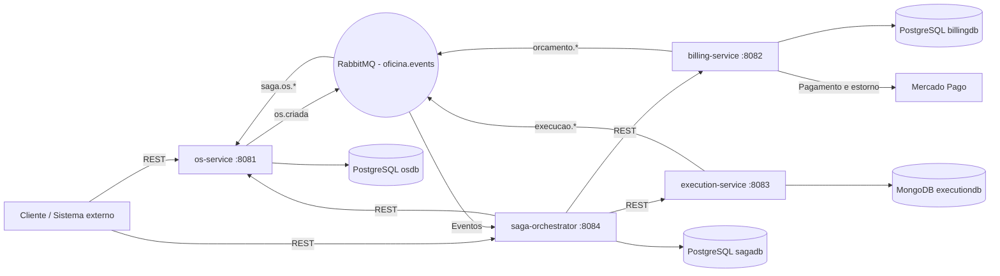

# Entrega Fase 4 — Grupo 310

- **Repositório principal:** https://github.com/daniloichaves/oficina-mecanica-tech
- **Participantes:**
    - Danilo Ischiavolini Chaves — RM372600
    - Rodrigo Dias Bragantini — RM372859
    - William de Oliveira Almeida — RM372192
- **Vídeo demonstrativo da Fase 4:** ensaio publicado no YouTube (13min40s) — https://www.youtube.com/watch?v=ZRiNr2rE-cM
    - _a versão final, com as evidências revisadas, ainda será regravada e republicada_

## Visão geral

A Fase 4 refatora a solução da oficina mecânica para uma **arquitetura de microsserviços** com gestão de transações distribuídas via **Saga Pattern Orquestrado**.

O domínio foi dividido em quatro serviços independentes, cada um com banco de dados próprio (PostgreSQL e MongoDB), comunicação síncrona por REST e assíncrona por RabbitMQ, integração de pagamento com o Mercado Pago, testes unitários e BDD com gate obrigatório de cobertura, containerização, manifestos Kubernetes e pipelines de CI/CD.

## Microsserviços da solução

| Serviço | Responsabilidade | Banco | Porta |
|---------|------------------|-------|-------|
| `os-service` | Ciclo de vida da Ordem de Serviço: abertura, consulta, atualização de status e cancelamento por compensação | PostgreSQL (`osdb`) | 8081 |
| `billing-service` | Orçamento, aprovação/rejeição, pagamento e estorno via Mercado Pago | PostgreSQL (`billingdb`) | 8082 |
| `execution-service` | Fila operacional: diagnóstico, reparo, finalização e entrega do veículo | **MongoDB** (`executiondb`) | 8083 |
| `saga-orchestrator` | Coordenação da transação distribuída e compensações | PostgreSQL (`sagadb`) | 8084 |

### Repositórios

A estrutura de cada microsserviço está completa e autocontida no repositório principal — código, `pom.xml`, `Dockerfile`, `k8s/manifests.yaml`, `.github/workflows/ci.yml`, README e evidências de cobertura:

- `fase4-priority1/os-service/`
- `fase4-priority2/billing-service/`
- `fase4-priority3/execution-service/`
- `fase4-priority4/saga-orchestrator/`

> **Pendência:** a publicação de cada microsserviço em seu próprio repositório Git remoto ainda não foi realizada. Os pipelines de cada serviço usam caminhos relativos ao próprio módulo e passam a executar automaticamente assim que os repositórios forem criados.

## Objetivos da fase

- Separar o monólito em microsserviços independentes por contexto de negócio
- Garantir banco de dados próprio por serviço, contemplando SQL e NoSQL
- Implementar comunicação síncrona (REST) e assíncrona (mensageria)
- Implementar o Saga Pattern com compensação automática em falhas e rejeições
- Integrar um gateway de pagamento externo ao fluxo de orçamento
- Garantir testes unitários e BDD com cobertura mínima obrigatória
- Containerizar, versionar os manifestos Kubernetes e automatizar o CI/CD
- Prover observabilidade e rastreabilidade entre os serviços

## Arquitetura da solução



Cada serviço acessa exclusivamente o próprio banco. Nenhum serviço de negócio conhece outro serviço de negócio: toda coordenação passa pelo orquestrador ou pela mensageria.

## Estratégia do Saga Pattern

### Decisão: Saga Orquestrado (ADR-001)

Adotamos o **Saga Pattern Orquestrado**, centralizado no `saga-orchestrator`, em vez do modelo coreografado.

**Contexto:** o fluxo de uma Ordem de Serviço atravessa três domínios distintos, um deles com integração de pagamento externo, exigindo visibilidade clara do estado da transação e coordenação determinística das compensações.

**Justificativa:**

- Evita dependência cíclica e acoplamento implícito entre os microsserviços de negócio
- Permite auditoria centralizada do estado e do histórico completo da transação, com rastreio por `X-Correlation-ID`
- Simplifica a inclusão de novas etapas e regras de compensação, como o estorno no Mercado Pago seguido do cancelamento da OS

**Trade-off:** o orquestrador vira um ponto central de coordenação. A mitigação é deploy stateless no Kubernetes com 2+ réplicas, HPA e persistência do estado da saga em banco próprio.

### Estados da saga

`ORCAMENTO_EM_ANDAMENTO` → `EXECUCAO_EM_ANDAMENTO` → `FINALIZADA`, com os estados terminais alternativos `CANCELADA` (rejeição do orçamento) e `COMPENSADA` (falha técnica em alguma etapa).

### Fluxo principal

1. O cliente abre a Ordem de Serviço no `os-service`.
2. O `saga-orchestrator` inicia a saga, solicita a criação do orçamento no `billing-service` e move a OS para `AGUARDANDO_APROVACAO`.
3. O `billing-service` registra a aprovação, a rejeição ou o pagamento do orçamento e publica o evento correspondente.
4. Com o orçamento aprovado ou pago, o orquestrador cria a execução no `execution-service` e move a OS para `EM_EXECUCAO`.
5. O `execution-service` conduz diagnóstico, reparo, finalização e entrega, publicando os eventos de cada etapa.
6. Ao receber a finalização ou a entrega, o orquestrador conclui a saga e atualiza a OS para `FINALIZADA` ou `ENTREGUE`.

### Compensação

| Gatilho | Compensação aplicada | Estado final |
|---------|----------------------|--------------|
| Falha ao gerar o orçamento | Cancelamento da OS | `COMPENSADA` |
| Orçamento rejeitado pelo cliente | Cancelamento da OS | `CANCELADA` |
| Falha ao iniciar ou executar o serviço | Estorno do orçamento no Mercado Pago e cancelamento da OS | `COMPENSADA` |

As compensações são tolerantes a falha parcial: o insucesso de um passo de rollback é registrado em log sem interromper os demais, de modo que a saga sempre alcança um estado terminal consistente.

## Isolamento de dados — SQL e NoSQL (ADR-002)

- **PostgreSQL (SQL)** para `os-service`, `billing-service` e `saga-orchestrator`, pela necessidade de integridade transacional e consistência financeira e de estados.
- **MongoDB (NoSQL)** para `execution-service`, pela flexibilidade documental da fila operacional e pela evolução independente dos atributos técnicos registrados na execução.

## Comunicação assíncrona

Exchange `oficina.events`:

| Routing key | Produtor | Consumidor | Ação |
|-------------|----------|------------|------|
| `os.criada` | `os-service` | `saga-orchestrator` | Inicia a saga e cria o orçamento |
| `orcamento.aprovado` / `orcamento.pago` | `billing-service` | `saga-orchestrator` | Avança a saga e inicia a execução |
| `orcamento.rejeitado` | `billing-service` | `saga-orchestrator` | Dispara a compensação e cancela a OS |
| `execucao.finalizada` / `execucao.entregue` | `execution-service` | `saga-orchestrator` | Atualiza a OS e finaliza a saga |
| `saga.os.*` | `saga-orchestrator` | `os-service` | Atualiza ou cancela a OS por comando assíncrono |

## Integração de pagamento

O `billing-service` encapsula o Mercado Pago atrás da porta `PaymentGateway`, com implementação `MercadoPagoPaymentGateway` e webhook em `POST /api/orcamentos/webhook/mercadopago` para confirmação assíncrona. O estorno é acionado pelo orquestrador como passo de compensação.

## Testes e cobertura

Gate obrigatório configurado no JaCoCo de cada serviço: `BUNDLE` / `LINE` ≥ 80%, executado na fase `verify`. Resultado da última execução de `mvn -B clean verify` (17/11/2026), todos com build `EXIT=0`:

| Serviço | Cobertura de linhas | Testes | Gate |
|---------|--------------------|--------|------|
| `os-service` | 95,7% (110/115) | 7 | Aprovado |
| `billing-service` | 97,9% (191/195) | 5 | Aprovado |
| `execution-service` | 98,6% (137/139) | 4 | Aprovado |
| `saga-orchestrator` | 97,4% (225/231) | 8 (5 unitários + 3 cenários BDD) | Aprovado |

Os prints dos relatórios JaCoCo estão publicados no README de cada serviço, em `<serviço>/docs/coverage-jacoco.png`.

O `saga-orchestrator` possui suíte **BDD com Cucumber**, cobrindo em Gherkin o fluxo completo da saga e os cenários de compensação por rejeição e por falha de execução.

## Containerização, Kubernetes e CI/CD

### Execução local

- `docker-compose.fase4.yml` — sobe 3 instâncias PostgreSQL, MongoDB, RabbitMQ e os 4 microsserviços
- `run-fase4-local.sh` / `stop-fase4-local.sh` — execução dos módulos em modo desenvolvimento

### Kubernetes

- `k8s/fase4-infra/infra.yaml` — namespace `oficina-fase4`, bancos e RabbitMQ
- `<serviço>/k8s/manifests.yaml` — Deployment com 2 réplicas, Service, HorizontalPodAutoscaler, probes e limites de CPU/memória

### Pipelines

- `.github/workflows/fase4-microservices.yml` — executa, em matriz para os 4 serviços, `clean verify` com o gate de cobertura, build da imagem Docker e, em seguida, deploy e validação de rollout em cluster kind
- `<serviço>/.github/workflows/ci.yml` — pipeline autocontido de cada serviço: build, testes, gate de cobertura, análise SonarQube, build da imagem e deploy em Kubernetes; passa a executar quando o serviço for publicado em repositório próprio

## Observabilidade e rastreabilidade

Implementado nos quatro serviços:

- Spring Boot Actuator com `/actuator/health` e `/actuator/prometheus`
- Métricas Micrometer em formato Prometheus, incluindo contadores de negócio da saga
- Logs estruturados em JSON via Logstash encoder
- `X-Correlation-ID` propagado por filtro HTTP, pelo MDC dos logs, pelas chamadas REST entre serviços e pelo estado persistido da saga
- Dashboard e monitores Datadog versionados em `docs/observability/datadog-dashboard.json`

### Stack local de monitoramento

O `docker-compose.fase4-observability.yml` sobe Prometheus e Grafana junto dos serviços, com datasource e dashboard provisionados por arquivos versionados em `docs/observability/fase4/`:

```bash
docker compose -f docker-compose.fase4.yml -f docker-compose.fase4-observability.yml up -d
```

- Prometheus em `http://localhost:9090`, coletando `/actuator/prometheus` dos quatro serviços a cada 5 segundos
- Grafana em `http://localhost:3000/d/oficina-fase4`, com disponibilidade, contadores de sagas, requisições de negócio, latência média, erros HTTP, memória e CPU

> **Escopo:** a stack local coleta métricas. O rastreamento entre serviços é feito pelo `X-Correlation-ID` nos logs e no histórico da saga; tracing distribuído com agregação de logs e Datadog ao vivo continua fora do escopo desta entrega.

## Documentação e collection

- Arquitetura, diagramas, ADRs e contrato de eventos: `docs/architecture/fase4/README.md`
- Dashboard local de métricas: `docs/observability/fase4/README.md`
- README por microsserviço, com diagrama, endpoints e evidências de cobertura
- Collection Postman: `docs/postman/oficina-mecanica-fase4.postman_collection.json`, com 11 requisições cobrindo o fluxo completo e a compensação
- Swagger UI em cada serviço: `http://localhost:<porta>/swagger-ui.html`

## Status da entrega

### Concluído no repositório

- [x] Separação em microsserviços independentes por contexto de negócio
- [x] Banco de dados próprio por serviço, com SQL e NoSQL
- [x] Comunicação síncrona (REST) e assíncrona (RabbitMQ)
- [x] Saga Pattern Orquestrado com compensação automática
- [x] Integração de pagamento com Mercado Pago, incluindo webhook e estorno
- [x] Testes unitários e BDD com cobertura acima do gate de 80% nos 4 serviços
- [x] Evidências de cobertura publicadas nos READMEs
- [x] Dockerfile, Docker Compose, manifestos Kubernetes e pipelines de CI/CD
- [x] Observabilidade em código, stack local de Prometheus e Grafana e documentação arquitetural com ADRs

### Pendências

- [ ] Publicação de cada microsserviço em repositório Git próprio
- [ ] Regravação e publicação da versão final do vídeo (o ensaio já está no YouTube)
- [ ] Envio desta entrega no portal do aluno

## Conclusão

A Fase 4 entrega a solução refatorada em quatro microsserviços independentes, com isolamento de dados em SQL e NoSQL, coordenação de transações distribuídas por Saga orquestrada com compensação verificada por testes BDD, integração de pagamento externo, cobertura de testes acima do gate exigido e automação completa de build, imagem e deploy. As pendências restantes são de publicação e demonstração, não de implementação.
