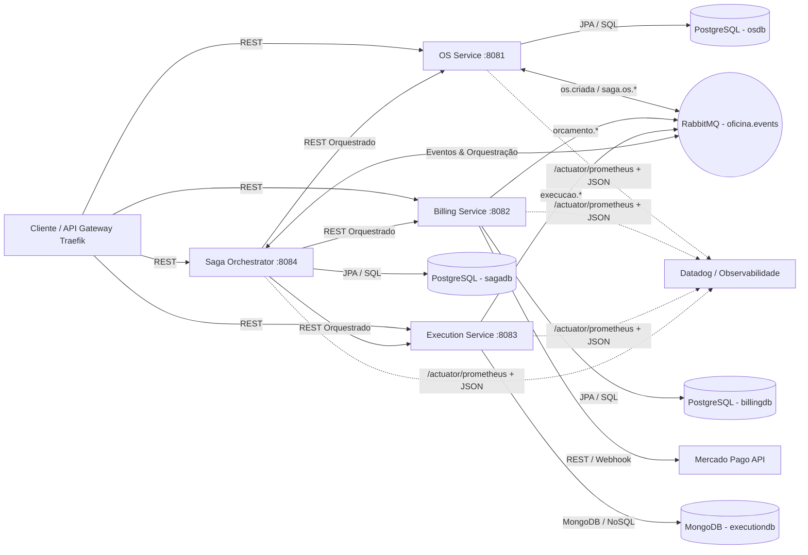
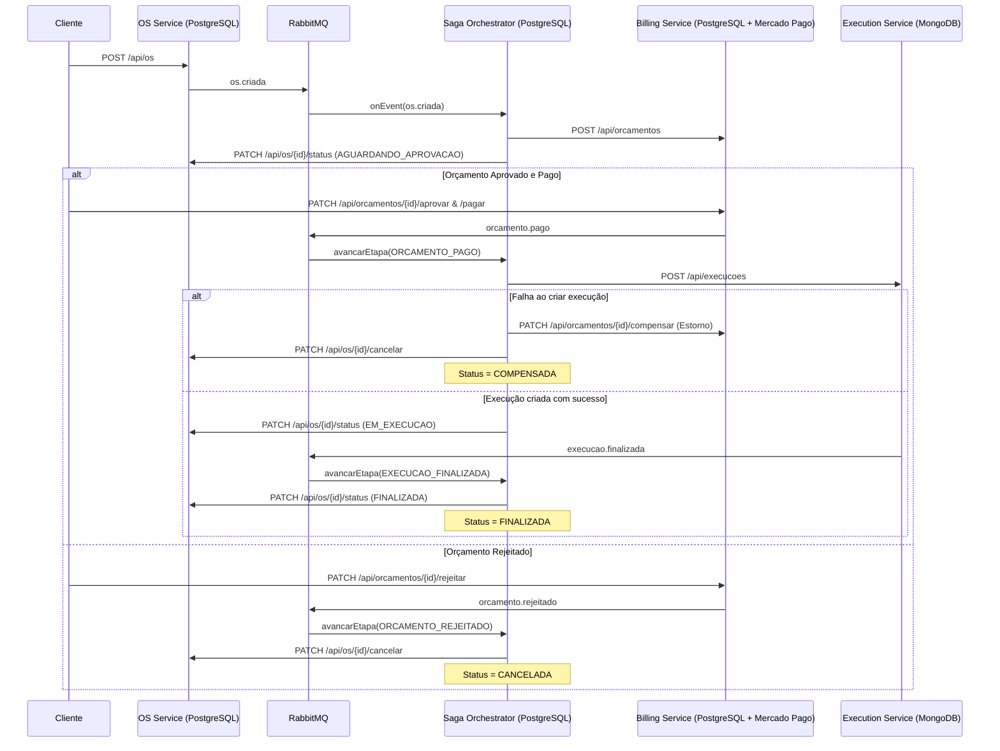

# Arquitetura — Fase 4 (Microsserviços e Saga Pattern)

## 1. Visão Geral e Diagrama de Componentes

A solução da Fase 4 decompõe o domínio da oficina mecânica em **4 microsserviços independentes**, cada um com seu próprio banco de dados isolado (atendendo ao uso obrigatório de **SQL** e **NoSQL**), comunicação síncrona via REST, mensageria assíncrona com **RabbitMQ** e observabilidade com JSON logs, `X-Correlation-ID`, Actuator/Prometheus e anotações **Datadog**.

## 2. Diagrama de Sequência — Fluxo Feliz e Compensação (Saga Orquestrada)

## 3. ADR-001 — Saga Pattern Orquestrado vs. Coreografado

* **Decisão:** Adotar o **Saga Pattern Orquestrado** centralizado no serviço `saga-orchestrator`.
* **Contexto:** O fluxo de uma Ordem de Serviço atravessa 3 domínios distintos (`os-service`, `billing-service` com pagamento externo no Mercado Pago e `execution-service`), exigindo visibilidade clara do estado da transação e coordenação determinística de compensações.
* **Justificativa:**
  * Evita dependência cíclica e acoplamento implícito entre os microsserviços de negócio (`os-service`, `billing-service` e `execution-service` não precisam conhecer uns aos outros).
  * Permite auditoria centralizada do estado e do histórico completo (`GET /api/sagas/ordens/{ordemId}`), facilitando troubleshooting com `X-Correlation-ID`.
  * Simplifica a adição de novas etapas ou regras de compensação (ex.: estorno no Mercado Pago + cancelamento da OS quando há falha no `execution-service`).
* **Trade-offs:** O `saga-orchestrator` torna-se um ponto central de coordenação, mitigado por deploy stateless em Kubernetes com 2+ réplicas, HPA e persistência de estado em PostgreSQL próprio.

## 4. ADR-002 — Isolamento de Dados (SQL + NoSQL)

* **Decisão:** Cada microsserviço possui banco de dados próprio e nenhum serviço acessa o banco de outro:
  * **PostgreSQL (SQL):** `os-service` (`osdb`), `billing-service` (`billingdb`) e `saga-orchestrator` (`sagadb`), pela necessidade de integridade transacional, chaves e consistência financeira/de estados.
  * **MongoDB (NoSQL):** `execution-service` (`executiondb`), pela flexibilidade documental da fila operacional de diagnóstico/execução e evolução independente de atributos técnicos de oficina.

## 5. Contrato de Eventos Assíncronos (`oficina.events`)

| Routing Key | Produtor | Consumidor | Ação |
|-------------|----------|------------|------|
| `os.criada` | `os-service` | `saga-orchestrator` | Inicia a Saga e cria orçamento |
| `orcamento.aprovado` / `orcamento.pago` | `billing-service` | `saga-orchestrator` | Avança Saga e inicia execução |
| `orcamento.rejeitado` | `billing-service` | `saga-orchestrator` | Dispara compensação e cancela OS |
| `execucao.finalizada` / `execucao.entregue` | `execution-service` | `saga-orchestrator` | Atualiza OS e finaliza a Saga |
| `saga.os.*` | `saga-orchestrator` | `os-service` | Atualiza ou cancela OS via comando assíncrono |
