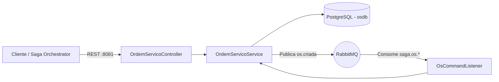

# OS Service (`os-service`)

Microsserviço responsável pelo ciclo de vida das Ordens de Serviço (abertura, consulta, atualização de status e cancelamento por compensação da Saga).

## Tecnologias

- Java 21 + Spring Boot 3.2.5
- Spring Data JPA + PostgreSQL (SQL) / H2 (testes locais)
- RabbitMQ (`spring-boot-starter-amqp`) — publica `os.criada` / `os.status.atualizado` e consome `saga.os.*`
- SpringDoc OpenAPI (Swagger) + Actuator + Prometheus + Logstash JSON (`X-Correlation-ID`)
- JUnit 5 + JaCoCo (cobertura mínima de 80%)

## Arquitetura do Serviço



## Endpoints e Documentação

- Swagger UI: `http://localhost:8081/swagger-ui.html`
- Collection Postman: [`docs/postman/oficina-mecanica-fase4.postman_collection.json`](../../docs/postman/oficina-mecanica-fase4.postman_collection.json)
- `POST /api/os` — Abrir nova OS
- `GET /api/os` | `GET /api/os/{id}` | `GET /api/os/status/{status}`
- `PATCH /api/os/{id}/status` | `PATCH /api/os/{id}/cancelar`

## Execução, Testes e Deploy

```bash
# Testes + verificação de cobertura JaCoCo >= 80%
mvn -B clean verify

# Execução local (H2)
mvn spring-boot:run

# Docker
docker build -t oficina-os-service .

# Kubernetes
kubectl apply -f k8s/
```
