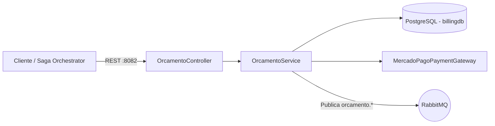

# Billing Service (`billing-service`)

Microsserviço responsável por geração de orçamentos, aprovação/rejeição, processamento/estorno de pagamentos integrados ao **Mercado Pago** e publicação de eventos financeiros para a Saga.

## Tecnologias

- Java 21 + Spring Boot 3.2.5
- Spring Data JPA + PostgreSQL (SQL) / H2 (testes locais)
- Integração Mercado Pago (`MercadoPagoPaymentGateway` + webhook `/api/orcamentos/webhook/mercadopago`)
- RabbitMQ (`spring-boot-starter-amqp`) — publica `orcamento.criado`, `orcamento.aprovado`, `orcamento.rejeitado`, `orcamento.pago`, `orcamento.compensado`
- SpringDoc OpenAPI (Swagger) + Actuator + Prometheus + Logstash JSON (`X-Correlation-ID`)
- JUnit 5 + JaCoCo (cobertura mínima de 80%)

## Arquitetura do Serviço



## Endpoints e Documentação

- Swagger UI: `http://localhost:8082/swagger-ui.html`
- Collection Postman: [`docs/postman/oficina-mecanica-fase4.postman_collection.json`](../../docs/postman/oficina-mecanica-fase4.postman_collection.json)
- `POST /api/orcamentos` — Gerar orçamento
- `GET /api/orcamentos` | `GET /api/orcamentos/{id}` | `GET /api/orcamentos/ordem/{ordemId}`
- `PATCH /api/orcamentos/{id}/aprovar` | `/rejeitar` | `/pagar` | `/compensar`
- `POST /api/orcamentos/webhook/mercadopago`

## Execução, Testes e Deploy

```bash
# Testes + verificação de cobertura JaCoCo >= 80%
mvn -B clean verify

# Execução local
mvn spring-boot:run

# Docker & Kubernetes
docker build -t oficina-billing-service .
kubectl apply -f k8s/
```
