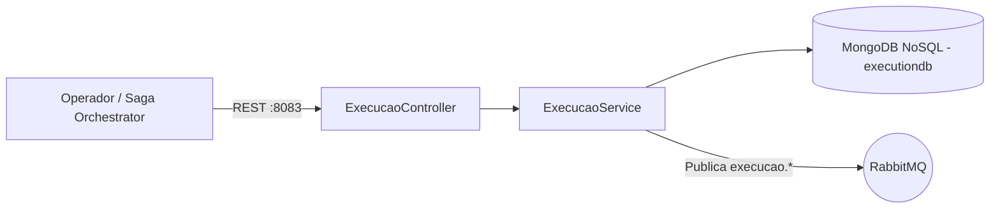

# Execution Service (`execution-service`)

Microsserviço responsável pela fila operacional de diagnóstico, reparo, finalização e entrega de veículos, persistindo documentos em banco **NoSQL (MongoDB)**.

## Tecnologias

- Java 21 + Spring Boot 3.2.5
- Spring Data **MongoDB** (NoSQL — `@Document(collection = "execucoes")`)
- RabbitMQ (`spring-boot-starter-amqp`) — publica `execucao.criada`, `execucao.iniciada`, `execucao.finalizada`, `execucao.entregue`, `execucao.cancelada`
- SpringDoc OpenAPI (Swagger) + Actuator + Prometheus + Logstash JSON (`X-Correlation-ID`)
- JUnit 5 + Mockito + JaCoCo (cobertura mínima de 80%)

## Arquitetura do Serviço



## Endpoints e Documentação

- Swagger UI: `http://localhost:8083/swagger-ui.html`
- Collection Postman: [`docs/postman/oficina-mecanica-fase4.postman_collection.json`](../../docs/postman/oficina-mecanica-fase4.postman_collection.json)
- `POST /api/execucoes` — Criar item na fila de execução
- `GET /api/execucoes` | `GET /api/execucoes/{id}` | `GET /api/execucoes/ordem/{ordemId}`
- `PATCH /api/execucoes/{id}/iniciar` | `/status` | `/finalizar` | `/entregar` | `/cancelar`

## Execução, Testes e Deploy

```bash
# Testes + verificação de cobertura JaCoCo >= 80%
mvn -B clean verify

# Docker & Kubernetes
docker build -t oficina-execution-service .
kubectl apply -f k8s/
```
