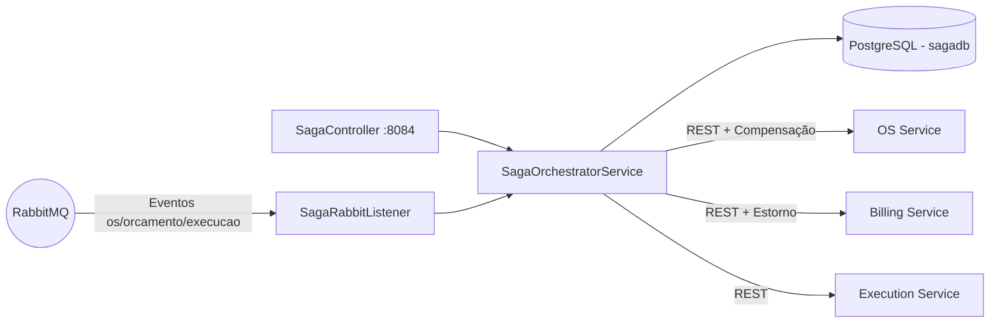
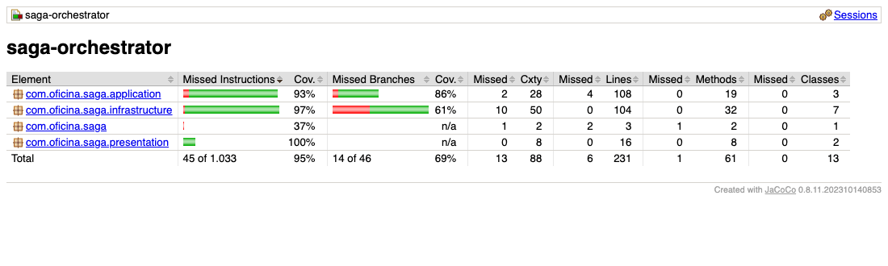

# Saga Orchestrator (`saga-orchestrator`)

Orquestrador central do **Saga Pattern** para coordenar transações distribuídas entre `os-service`, `billing-service` e `execution-service`, garantindo rollback e compensação em falhas ou rejeições.

## Escolha da Estratégia (Orquestrada vs. Coreografada)

Adotamos a abordagem **Orquestrada** porque o fluxo de oficina envolve compensações coordenadas entre múltiplos domínios (estorno no Mercado Pago + cancelamento da OS), exigindo rastreabilidade centralizada em banco próprio (`sagadb`) e ausência de acoplamento direto entre os serviços de negócio.

## Tecnologias

- Java 21 + Spring Boot 3.2.5
- Spring Data JPA + PostgreSQL (SQL) / H2 (testes locais)
- RabbitMQ (`spring-boot-starter-amqp`) + `RestClient` com propagação `X-Correlation-ID`
- **Cucumber BDD** (cenários Gherkin para fluxo completo e compensações) + JUnit 5 + JaCoCo (>= 80%)
- SpringDoc OpenAPI (Swagger) + Actuator + Prometheus + Logstash JSON

## Arquitetura do Serviço



## Endpoints e Documentação

- Swagger UI: `http://localhost:8084/swagger-ui.html`
- Collection Postman: [`docs/postman/oficina-mecanica-fase4.postman_collection.json`](../../docs/postman/oficina-mecanica-fase4.postman_collection.json)
- `POST /api/sagas/ordens/{ordemId}/iniciar`
- `POST /api/sagas/ordens/{ordemId}/eventos?evento=...`
- `GET /api/sagas/ordens/{ordemId}` | `GET /api/sagas`

## Execução, Testes BDD e Deploy

```bash
# Testes unitários + suíte BDD Cucumber + cobertura JaCoCo >= 80%
mvn -B clean verify

# Docker & Kubernetes
docker build -t oficina-saga-orchestrator .
kubectl apply -f k8s/
```

## Evidências de Cobertura de Testes

Execução de `mvn -B clean verify` em 17/11/2026 — gate JaCoCo (`BUNDLE` / `LINE`) aprovado, build `EXIT=0`.

| Métrica | Resultado | Gate |
|---------|-----------|------|
| Cobertura de linhas | **97,4%** (225/231 linhas) | ≥ 80% ✅ |
| Testes executados | 8 testes (5 unitários + 3 cenários BDD Cucumber) | 0 falhas, 0 erros ✅ |



- Relatório HTML completo: `target/site/jacoco/index.html` (gerado por `mvn clean verify`)
- Gate executado no pipeline: [CI/CD Microsserviços (Fase 4)](https://github.com/daniloichaves/oficina-mecanica-tech/actions/workflows/fase4-microservices.yml)
